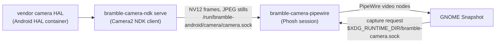

# Cameras

The Pixel 4a (5G) has three cameras: the main rear camera (Sony IMX363,
12 MP, OIS), the rear ultrawide (16 MP sensor) and the front camera
(8 MP). They work in GNOME Snapshot (the Camera app): live viewfinder for
each camera, full-resolution photos, and video.

## How it works

The sensors sit behind Qualcomm's CAMX kernel drivers, and only Google's
closed camera HAL drives them (3A, ISP tuning, JPEG). There is no open
userspace for CAMX and mainline camss does not support SM7250, so the port
runs the phone's own HAL:

- `bramble-android-hal` runs Android 14 init from the Halium system image
  with the vendor partition in private namespaces, and starts only the
  camera and fingerprint services (see [porting-notes.md](porting-notes.md),
  "Android HAL container").
- `bramble-camera-ndk serve` (built with the Android NDK from
  `tools/android-helpers/`) opens a camera while a client is connected. It
  runs one capture session with two outputs: a YUV viewfinder stream and a
  full-size JPEG output. The client sends `<camera-id> <width> <height>
  <zoom>` and gets NV12 frames; `capture <rotation>` takes a still with
  `TEMPLATE_STILL_CAPTURE`, which the HAL processes and encodes itself.
- `bramble-camera-pipewire` (started in every Phosh session) offers three
  PipeWire camera nodes: "Back camera", "Ultrawide camera" (the logical rear
  camera at its widest zoom, which the HAL serves from the ultrawide
  sensor) and "Front camera". Frames go from the socket straight into the
  PipeWire buffers, unrotated, with a video transform that tells the app
  how the sensor is mounted. It opens a camera only while an app streams
  from it.
- Snapshot (patched, `temp/snapshot`) takes photos by asking the bridge for
  a HAL still instead of saving a viewfinder frame. The photo gets the
  device rotation from iio-sensor-proxy, so it is upright however the
  phone was held. Videos are recorded from the viewfinder stream.

## What you get

| Camera | Photo | Viewfinder and video |
|---|---|---|
| Back | 4032x3024 JPEG, about 0.3 s | 1600x1200, 30 fps |
| Ultrawide | 4032x3024 JPEG, about 0.3 s | 1600x1200, 30 fps |
| Front | 3264x2448 JPEG, about 0.25 s | 1600x1200, 30 fps |

Videos are H.264 with AAC sound in MP4 (Snapshot's software encoder keeps
up at 1600x1200; at 2048x1536 it records under 20 fps).

Photos carry the HAL's EXIF data (make, model, orientation). Front photos
are not mirrored, as on Android; the front viewfinder is mirrored like a
mirror.

## Use

Open Camera (Snapshot) and switch cameras with the camera button. From a
shell, `sudo bramble-camera photo back|wide|front FILE` takes a photo
without an app.

## Limits

- No HDR+, night mode or other Google Camera processing: that is in the
  Google Camera app, not the HAL. Photos are what the HAL's still pipeline
  gives (noise reduction, sharpening, 3A).
- Video is at viewfinder size (1600x1200) and encoded in software by
  Snapshot, so it uses a lot of CPU while recording.
- Only one camera can be open at a time, and the first time after boot the
  ultrawide can take several seconds to start.
- The flash LED is not used for photos.

## Problems found on the way

- The camera provider aborts (CamX `WaitOutFlush`) when an image reader
  callback blocks: the HAL waits for its buffers back. The NDK helper
  therefore never writes to the socket from a callback; a sender thread
  does, and a slow client loses preview frames instead of stalling the HAL.
- A PipeWire enum choice is the default followed by all allowed values.
  The first version listed only the sizes, so the default was not among
  the allowed values (and a single size left none); Snapshot then stopped
  taking frames after a few.
- A frame cut short must not be queued, even with an empty chunk: GTK's
  texture upload in Snapshot read past it and crashed.
- The bridge is started by gnome-session, sometimes before PipeWire; it
  now waits for PipeWire instead of exiting.
- The first ultrawide session after the container starts can take
  several seconds, and once it hung until the provider restarted.
